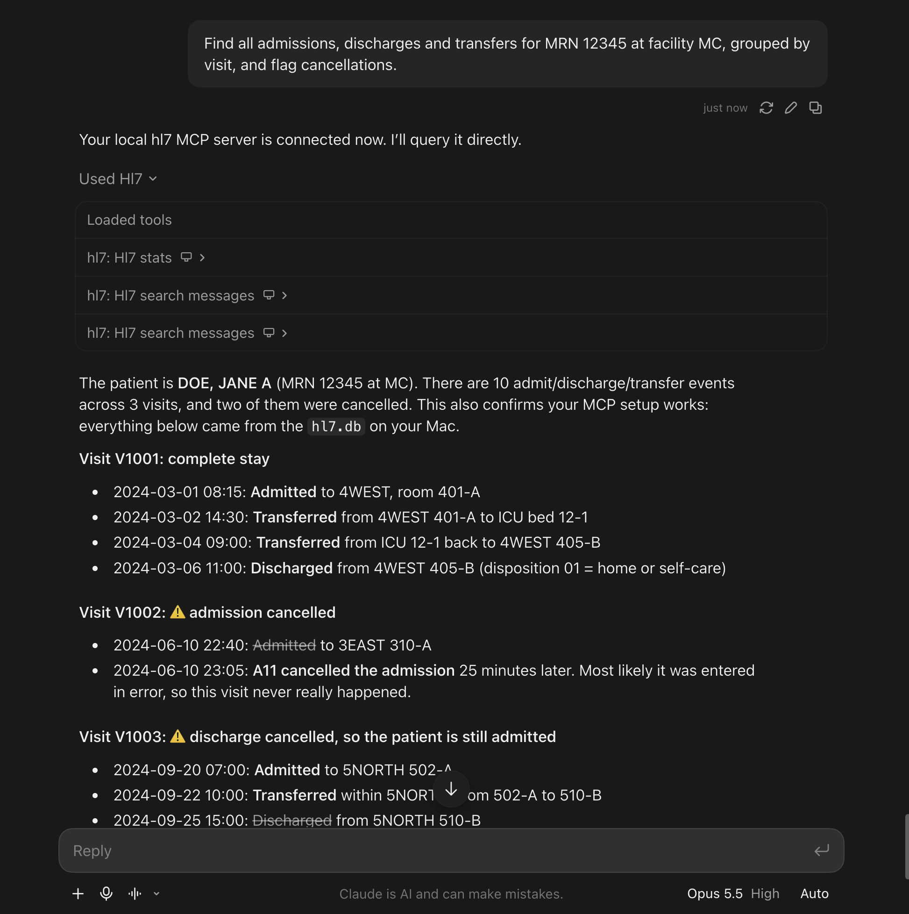

# Live demo: Claude using the HL7 MCP server

**Date:** 2026-11-21 · **Agent:** Claude (Opus 5.5) in the Claude app ·
**Server:** `hl7-mcp` running locally on macOS over stdio · **Data:** the 19 synthetic
messages from `hl7-seed`, ingested through `hl7-server` over MLLP.

No API key, no scripted query: the agent got one sentence and chose every tool call itself.

> **Prompt:** "Find all admissions, discharges and transfers for MRN 12345 at facility MC,
> grouped by visit, and flag cancellations."



*The "Used Hl7" panel shows the three MCP calls the agent made.*

## Setup used

```bash
cd ~/Projects/hl7-agent-search && source .venv/bin/activate
hl7-server --db "$PWD/hl7.db" &     # ingest server (creates hl7.db)
hl7-seed                            # sent 19 messages, 19 accepted (AA)
```

Claude app MCP config (Settings → Developer → Edit Config):

```json
{
  "mcpServers": {
    "hl7": {
      "command": "/Users/pratikshit/Projects/hl7-agent-search/.venv/bin/hl7-mcp",
      "env": { "HL7_DB": "/Users/pratikshit/Projects/hl7-agent-search/hl7.db" }
    }
  }
}
```

## What the agent did

| # | Tool call | Why | Result |
|---|---|---|---|
| 1 | `hl7_stats()` | See what data exists | 19 messages; ADT includes **A11** and **A13** cancellations, so cancellations must be handled |
| 2 | `hl7_search_messages` with MRN **+ assigning authority**, `scope="repetition"`, ADT triggers A01/A02/A03/A11/A12/A13 | The actual answer | **10** events for DOE^JANE^A |
| 3 | `hl7_search_messages` with MRN **only** | Check whether the MRN is unique | **13** hits: also **ROE^RICHARD at OTHERHOSP** and an A08 update, confirming why call 2 had to be scoped |

Call 2, exactly as the agent sent it:

```json
{
  "filters": [
    {"path": "PID.3.1", "op": "eq", "value": "12345"},
    {"path": "PID.3.4", "op": "eq", "value": "MC"}
  ],
  "scope": "repetition",
  "message_type": "ADT",
  "trigger_events": ["A01", "A02", "A03", "A11", "A12", "A13"],
  "return_fields": ["PV1.19", "PV1.3", "PV1.6", "PV1.36", "PID.5"]
}
```

Results (sorted by event time by the tool; note `message_id` = arrival order, which was shuffled):

| Event time | Event | Control ID | msg id | Visit (PV1-19) | Location (PV1-3) | Prior (PV1-6) |
|---|---|---|---|---|---|---|
| 2024-03-01 08:15 | A01 admit | MC0001 | 9 | V1001 | 4WEST^401^A | |
| 2024-03-02 14:30 | A02 transfer | MC0002 | 16 | V1001 | ICU^12^1 | 4WEST^401^A |
| 2024-03-04 09:00 | A02 transfer | MC0003 | 2 | V1001 | 4WEST^405^B | ICU^12^1 |
| 2024-03-06 11:00 | A03 discharge (dispo 01) | MC0004 | 8 | V1001 | 4WEST^405^B | |
| 2024-06-10 22:40 | A01 admit | MC0006 | 11 | V1002 | 3EAST^310^A | |
| 2024-06-10 23:05 | **A11 cancel admit** | MC0007 | 6 | V1002 | 3EAST^310^A | |
| 2024-09-20 07:00 | A01 admit | MC0008 | 5 | V1003 | 5NORTH^502^A | |
| 2024-09-22 10:00 | A02 transfer | MC0009 | 13 | V1003 | 5NORTH^510^B | 5NORTH^502^A |
| 2024-09-25 15:00 | A03 discharge | MC0010 | 10 | V1003 | 5NORTH^510^B | |
| 2024-09-25 16:20 | **A13 cancel discharge** | MC0011 | 19 | V1003 | 5NORTH^510^B | |

## The agent's answer

**DOE, JANE A (MRN 12345 at MC), 3 visits:**

- **V1001, complete stay:** admitted to 4WEST 401-A → ICU 12-1 → back to 4WEST 405-B →
  discharged 2024-03-06 (disposition 01, home).
- **V1002, ⚠️ admission cancelled:** A01 at 22:40 was cancelled by A11 at 23:05. The visit
  never really happened.
- **V1003, ⚠️ discharge cancelled:** admitted to 5NORTH 502-A, transferred to 510-B,
  discharged at 15:00, then A13 cancelled the discharge at 16:20. As far as this data shows,
  **she is still an inpatient** in 5NORTH 510-B.

**Excluded on purpose:** ROE, RICHARD (same MRN 12345, different facility, OTHERHOSP), and an
A08 demographics update (an ADT message, but not an admission, discharge or transfer).

## Correctness check

The 10 control IDs, in order, equal `EXPECTED_JANE_ADT_CONTROL_IDS` in
`src/hl7search/seed.py`, the ground truth that `tests/test_store.py` and
`tests/test_mcp.py` also assert. All four traps built into the seed data were handled:

| Trap | Handled by |
|---|---|
| Same MRN at two facilities | Filtering PID-3.1 **and** PID-3.4 with `scope="repetition"` |
| Cancelled admit (A11) and cancelled discharge (A13) | Including cancel triggers and pairing them by visit number |
| A08 / A04 are ADT but not admit/discharge/transfer | Trigger-event filter |
| Messages arrived shuffled | Tool sorts by event time (EVN-6), not arrival |

## Setup pitfalls hit along the way

1. **Don't keep the project in `~/Desktop`, `~/Documents` or `~/Downloads` on macOS.**
   macOS privacy protection blocks processes started by the Claude app from reading those
   folders, so Python failed on startup with
   `PermissionError: ... .venv/pyvenv.cfg`. Moving the repo to `~/Projects` fixed it.
2. **The database must exist before the MCP server starts.** `hl7-mcp` only reads; `hl7-server`
   creates `hl7.db`. Without it the server exits with `FileNotFoundError` and the app only
   shows "Server disconnected". (Improvement: start anyway and return that message from each
   tool call, so the agent can tell the user what to do.)
